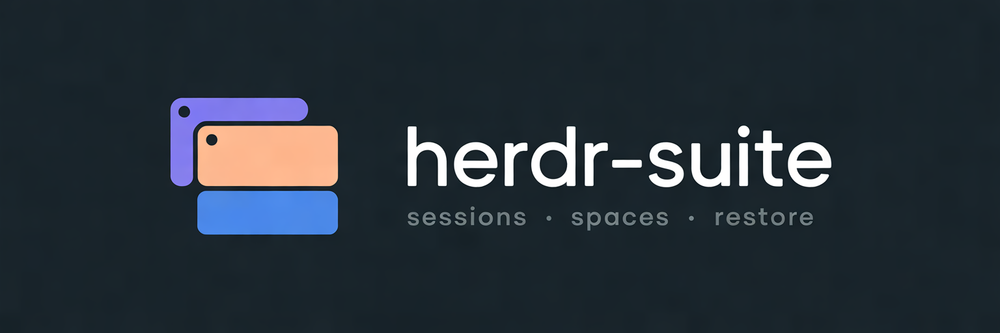
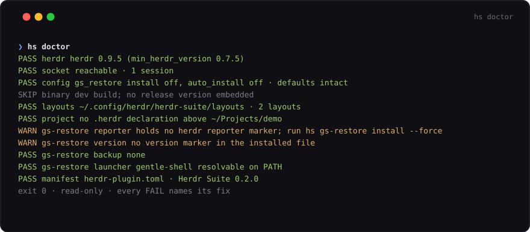
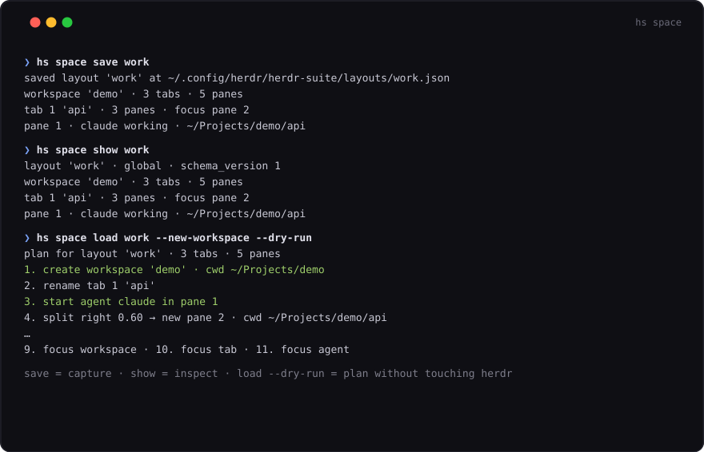

<p align="center">
  
</p>

[](https://github.com/WilberC/herdr-suite/actions/workflows/ci.yml)
[](https://github.com/WilberC/herdr-suite/actions/workflows/release.yml)
[](LICENSE)

**Session switching and workspace layout snapshots for
[herdr](https://herdr.dev)** — one Go binary, two surfaces: an interactive
switcher and a scriptable CLI that doubles as herdr plugin actions.

## What it solves

- **Sessions without typing commands** — attach, create, stop, restart or delete
  named sessions from one popup, or script them with stable exit codes.
- **Workspaces that cannot be restored** — snapshot a workspace's split tree
  (directions, ratios, labels, cwds, agents) and recreate it exactly,
  with a dry-run plan first.
- **Gentle Shell restores as Gentle Shell** — an optional, default-off reporter
  so herdr relaunches your sessions through the `gentle-shell` launcher instead
  of vanilla pi.

| health check · `hs doctor` | spaces · `hs space` |
| --- | --- |
|  |  |

## Quick start

```bash
herdr plugin install WilberC/herdr-suite   # fetch the plugin; its build hook provisions bin/hs
herdr plugin action invoke herdr-suite.hs-path   # put `hs` on PATH — also prefix+p → the action, inside herdr
hs version                                 # the binary runs and names the release it was built as
hs doctor                                  # herdr, socket, config, binary and layout store in one pass
hs gs-restore install                      # optional: gentle-shell sessions come back through its launcher, then /reload in pi
hs space save work                         # snapshot the active workspace as the layout "work"
hs space load work                         # recreate that layout in the active workspace
```

`hs` is not on PATH the instant the plugin installs — that is what the second
line fixes: the action runs the plugin's own binary from its root and writes a
small `hs` shim into `~/.local/bin` that resolves the plugin root every time it
runs, so `hs` keeps working after a plugin update. Press `prefix+p` instead if
you prefer doing it from the plugin manager popup. Each step has its own section
— [Install](docs/install.md), [Version and doctor](docs/health.md), [GS session
restore](docs/gs-restore.md) and [Spaces](docs/spaces.md) — and [Shell
completions](docs/install.md#shell-completions) covers the fish script.

Every behavior above is covered by offline tests (the herdr surface is a fake
in tests, so no test ever touches a socket), and every release binary is
smoke-tested by the release workflow itself. Destructive commands always ask
first, and non-interactive output keeps stable exit codes and stdout — the
binary is built to run from scripts and plugin actions, not only from hands.

## Cheatsheet

| Command | Does | Detail |
| --- | --- | --- |
| `hs` | interactive switcher over sessions; needs a terminal | [sessions](docs/sessions.md#switcher) |
| `hs attach <name>` | replace this shell with the attached client | [sessions](docs/sessions.md) |
| `hs session list` | stable `NAME`/`STATE` table, `--json` for scripts | [sessions](docs/sessions.md) |
| `hs session create <name>` | create a session by attaching it | [sessions](docs/sessions.md) |
| `hs session stop <name>` | stop a running session | [sessions](docs/sessions.md) |
| `hs session restart <name>` | stop it so the next attach starts fresh | [sessions](docs/sessions.md) |
| `hs session delete <name>` | stop it first, then delete it | [sessions](docs/sessions.md) |
| `hs session fork [session] [layout]` | snapshot a whole session as one layout | [sessions](docs/sessions.md#forking-a-session) |
| `hs space save <name>` | snapshot the active workspace as a layout | [spaces](docs/spaces.md#saving-a-space) |
| `hs space load <name>` | recreate a stored layout, with a dry-run plan first | [spaces](docs/spaces.md#restoring-a-space) |
| `hs space show <name>` | print a stored layout without touching a session | [spaces](docs/spaces.md#showing-a-space) |
| `hs space list` | every layout visible from here, with its scope | [spaces](docs/spaces.md#project-layouts) |
| `hs gs-restore install\|remove\|status` | the gentle-shell reporter, default off | [gs-restore](docs/gs-restore.md) |
| `hs path install\|remove\|status` | put `hs` on `PATH` with an update-safe shim | [install](docs/install.md#path) |
| `hs last workspace\|tab` | toggle to the previous workspace or tab | [last](docs/last.md) |
| `hs version [--check]` | the release this binary was built as, against the manifest | [health](docs/health.md) |
| `hs doctor` | herdr, socket, config, binary and layout store in one pass | [health](docs/health.md) |
| `hs completions fish` | print or install the fish completion script | [install](docs/install.md#shell-completions) |

## Documentation

| Document | Covers |
| --- | --- |
| [Install](docs/install.md) | plugin install, the manual binary download and its checksum, the `[[build]]` hook, the `hs` PATH shim, fish completions |
| [Sessions](docs/sessions.md) | the switcher and every `hs session` subcommand, including fork and confirmations |
| [Spaces](docs/spaces.md) | save/load/show/list, the dry-run plan, `--replace`, project layouts, layout storage and forked layouts |
| [GS session restore](docs/gs-restore.md) | the default-off gentle-shell reporter: toggles, install/remove/status, the single-reporter rule |
| [Inside herdr](docs/inside-herdr.md) | the declared actions and panes, keybindings, how they resolve `bin/hs` |
| [Last](docs/last.md) | the previous-workspace and previous-tab toggles, their ephemeral hooks and state file |
| [Health](docs/health.md) | `hs version`, every `hs doctor` check, and the exit codes |
| [Development](docs/development.md) | offline tests, `make` targets, the release flow and the repository layout |

## License

[MIT](LICENSE).

Contributing: [CONTRIBUTING.md](CONTRIBUTING.md) · Changes:
[CHANGELOG.md](CHANGELOG.md) · Security:
[.github/SECURITY.md](.github/SECURITY.md) · Development:
[docs/development.md](docs/development.md).
